# Contagion 1.2

Contagion is a dual-core, eight-voice wavetable synth firmware for the M‑VAVE FM‑1. Version 1.2 adds two generative sequencer modes, eight USER sequence snapshots, and a 32-slot USER patch browser. It includes all 1,525 factory presets and the 34-table flash cache. [Sound sample](Sound%20Sample.mp3)

## Downloads

- [Contagion 1.2 firmware and USB editor](https://github.com/Kayman18/Contagion/releases/tag/v1.2.0)
- [Firmware checksums](firmware/SHA256SUMS-1.2)
- [USB editor source and setup](web-editor/README.md) · [MIDI controls](MIDI-CONTROLS.md)

Install `Contagion-1.2-All-Banks-8V.fwsc` through the FM‑1 updater. This build uses firmware ID `FM-1_15012008`. USB‑C provides MIDI and SysEx for the editor, and audio comes from the analog output. The firmware preserves the original factory program numbers, including gaps where arpeggiated presets were omitted.

All screenshots below are 240 × 240 framebuffer captures from the firmware simulator.

## Sequencers

Press **SEQ** to open the sequencer and cycle through its pages. Press **PLAY** to start or stop. Use **Setup → K1** to select the lane you’re editing and **Mode and Lanes → K2/K3** to turn the lanes on and off. Both lanes share tempo, root, scale, and the current synth patch. A polyphonic patch can play both lanes at once.

### OXI Style

OXI Style plays a clocked pattern of up to 32 steps per lane. Each lane can use a different length and division.

| Note Weights | Rhythm | Evolve |
| :---: | :---: | :---: |
| 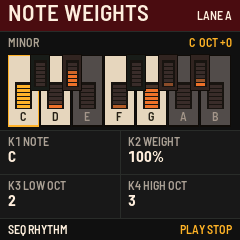 | 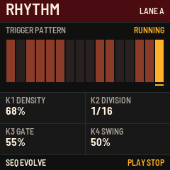 | 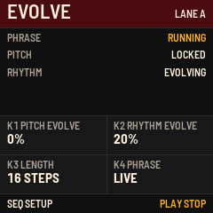 |

| Page | K1 | K2 | K3 | K4 |
| --- | --- | --- | --- | --- |
| **Note Weights** | Select an in-scale note | Adjust its weight | Set low octave | Set high octave |
| **Rhythm** | Trigger density | Step division | Gate length | Swing |
| **Evolve** | Pitch evolution | Rhythm evolution | Phrase length in steps | Live or Hold |

- **Note Weights** uses the LED level to show each note’s weight. The amber outline marks the edit cursor. During playback, the edited lane lights its sounding key amber and the other lane lights its key red. A weight of zero excludes that pitch from new draws.
- **Rhythm** shows which steps trigger. **Density** sets the trigger cutoff, with all steps active at 100% and no triggers at 0%. Density can change while a phrase is held. **Gate** sets the time a note is held as a percentage of the step. **Swing** shifts alternating steps.
- **Evolve** controls how often pitches and trigger rolls are refreshed on each pass. Set either control to 0% to freeze that part, or choose **Hold** to freeze both.

### SIG+ Style

SIG+ chooses event durations from weighted divisions. Each lane can generate a different pattern of notes and rests on the shared clock.

| Note Weights | Durations | Articulation |
| :---: | :---: | :---: |
| 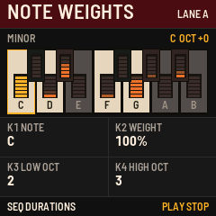 | 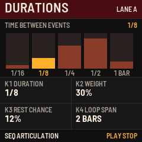 | 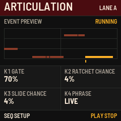 |

| Page | K1 | K2 | K3 | K4 |
| --- | --- | --- | --- | --- |
| **Note Weights** | Select an in-scale note | Adjust its weight | Set low octave | Set high octave |
| **Durations** | Select a note division | Adjust its weight | Set rest chance | Set loop span in bars |
| **Articulation** | Gate length | Ratchet chance | Slide chance | Live or Hold |
| **Morph** | Morph amount | | | |

- **Durations** lets you favor events from a sixteenth note through one bar. Weights are relative. A zero weight excludes that division, and setting all duration weights to zero falls back to sixteenth notes. Rest chance makes an event silent for its selected duration.
- **Articulation** sets gate length and the chances of repeated pulses and slides. The Event Preview shows pitch vertically and time horizontally. The bottom tick marks playback. **Hold** finishes the current pass and loops it. **Live** generates a fresh phrase at the next loop boundary.
- **Morph** varies the odds of enabled non-root notes according to event division and phrase position. The root keeps its original probability. At **0%**, Morph is off. It affects newly generated events, and a held phrase repeats its captured notes.

[Listen to the ratchet and slide demo](Sequencer%20-%20Ratchet%20and%20Slide%20Demo.mp3)

### Setup and lane controls

| OXI Setup | OXI Mode and Lanes | SIG+ Setup |
| :---: | :---: | :---: |
|  | 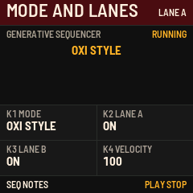 | 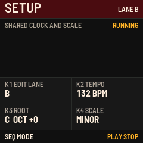 |

| SIG+ Mode and Lanes | SIG+ Morph |
| :---: | :---: |
| 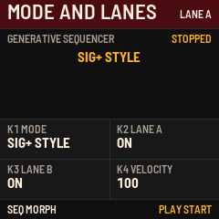 | 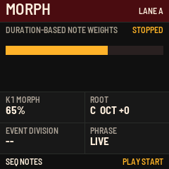 |

| Page | K1 | K2 | K3 | K4 |
| --- | --- | --- | --- | --- |
| **Setup** | Select lane to edit | Tempo | Root | Scale |
| **Mode and Lanes** | Select OXI or SIG+ | Lane A on/off | Lane B on/off | Velocity |

On any **SEQ** page, **OCT− / OCT+** shifts both sequencer lanes by up to two octaves. On other pages the same buttons change the playing keyboard’s octave. Changing sequencer mode stops playback. While a sequence is running, **PLAY** stops it from any page.

## Factory, USER patch, and USER sequence browsers

Tap **SEL** (labelled **SCL** on the FM‑1) to cycle through these three pages.

| SCL 1 · Factory Presets | SCL 2 · USER Patches | SCL 3 · USER Sequences |
| :---: | :---: | :---: |
|  | 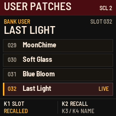 | 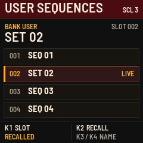 |

| Page | Browse and recall | Save |
| --- | --- | --- |
| **Factory Presets** | **K1** changes bank, **K2** selects and loads a program, **K3** loads INIT, and **K4** adjusts volume. The dedicated **PRESET** knob also opens the factory browser. | |
| **USER Patches** | **K1** auto-loads an occupied slot after you pause. **K2** recalls the selected slot immediately. **LIVE** marks the loaded slot. | **K3/K4** edit the name. In name-edit mode, **K1** selects the destination. Press **SAVE** to write the patch. |
| **USER Sequences** | **K1** selects a slot and **K2** recalls it. Recall keeps the current synth patch and stops the sequencer. Press **PLAY** to start from the beginning. | **K3/K4** edit the name, **K1** selects the destination, and **SAVE** writes the snapshot. |

The **32 USER patch slots** store synth parameters and modulation routes. Patches named and written in the USB editor show those names on the FM‑1. The **8 USER sequence slots** store both modes and lanes, clock, root, scale, octave shift, velocity, Morph, and captured Hold phrases.

### Name and save from the FM‑1

1. **USER Patches:** Load or edit the sound you want to keep. Open **SCL 2** and turn **K3** or **K4** to enter name editing before choosing a populated destination. This changes **K1** to **DEST**, so choosing a slot keeps the current sound.
2. **USER Sequences:** Set up or capture the sequence, open **SCL 3**, and use **K1** to pick the destination.
3. On either page, turn **knob 3** to move the character cursor and **knob 4** to change the character. **Press the physical SAVE button to finish.** The screen shows **SAVED** after the write succeeds.

| Naming a USER patch | Naming a USER sequence |
| :---: | :---: |
|  | 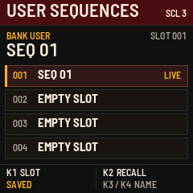 |

USER patch and sequence banks use separate flash storage with two copies per bank. Slots 001–016 retain their original address and format. Back up important patches in the USB editor before updating.

## Main panel

| Loading splash | Oscillators | Filter | Performance |
| :---: | :---: | :---: | :---: |
|  |  | 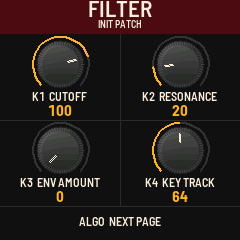 |  |

Turn **ALGO** to move through the pages. Repeated taps on **HOME**, **ENV**, **LFO**, **FX**, or **GLO** step through that section. Under **GLO**, the Performance page shows CPU average and peak, xruns, and deadlines. **Wave Cache → Flash Hits** counts pre-rendered tables loaded since startup.

## How the wavetables fit

| Data | Size |
| --- | ---: |
| Full rendered set, 64 waves × 14 pitch bands × 2,049 float32 samples | 7,343,616 bytes |
| Packed coefficient bank, including header and index | 90,426 bytes |
| 34 pre-rendered tables, index and checksums before padding | 278,956 bytes |
| 32 playable tables in the RAM cache | 262,272 bytes |

The packed size is for the coefficient bank itself. The firmware also keeps a shared sine lookup table and per-wave peak constants. Tables in RAM are indexed by **wave number and pitch band**. A slot holds one band of one wave, so several voices or oscillators can reuse the same slot.

### Coefficients in flash

Each wave carries 128 sine and 128 cosine weights as binary64 values. The coefficients are stored in independently compressed blocks, so the firmware can decode a single wave by consulting its offset and length in the index. The bank reader checks the header, index, and payload CRCs and verifies each unpacked 2,048-byte coefficient block. See [bank decoder](runtime/wavetable_bank.c).

The app reads these coefficients from its own embedded bank on all FM‑1 units. The updater installs an additional 276 KiB data image at `0x97000–0xDBFFF`. It holds 34 float32 tables, a CRC32 for each table, and a CRC32 for their index. The loader verifies the package before writing and verifies the data again after programming. USER storage is outside this span.

On a cache hit, the app copies the pre-rendered samples into a playback slot in RAM. It checks the index at startup and checks each table on first use. A miss or bad checksum falls back to the embedded coefficients. This avoids overwriting audio-owned RAM from the loader or reading serial flash in the sample loop.

### Rebuilding a playable table

1. The oscillator derives a band from pitch. Lower bands can retain more harmonics. Higher pitch bands cut progressively more partials to limit aliasing. The 14 bands use harmonic ceilings of 128, 96, 64, 48, 32, 24, 16, 12, 8, 6, 4, 3, 2, and 1.
2. The builder expands one wave's coefficients into scratch memory. For each sample it adds the selected harmonics in reference order. The cosine lookup is the same sine table shifted by a quarter cycle.
3. It computes 32-sample tiles with double-precision accumulation, applies the wave's normalization and stores float32 samples. Sample 2,048 repeats sample zero so interpolation wraps without a special case.
4. The result becomes eligible for playback only after all tiles are written. All 896 reconstructed wave-band pairs matched the float32 reference byte for byte. See [reconstruction](runtime/wavetable_rebuild.c).

### Scheduling and moving between waves

On startup or preset recall, the app mutes while it prepares the selected waves. It warms the fundamental and bands 0–4 for each of the three oscillator selections, reusing duplicates. This gives typical notes an immediately usable table. A loading indicator remains visible during startup.

During playback, up to 24 oscillator clients request wave-band pairs. Cache misses are serviced in bounded slices by the main loop. The audio workers keep rendering while replacements are built. A cold note can use a smaller harmonic set of the same wave while it waits for the exact band. A wave with very little fundamental energy can sound thinner or nearly silent during that window. A fast modulation sweep can move through selections faster than the builder completes them, so intermediate requests may be superseded.

The cache publishes completed pointers at an audio boundary. It pins old and new tables until the audio side acknowledges the handoff, preventing a renderer from reading a slot while it is being reused. The oscillator keeps its phase and applies a 128-sample correction to smooth the change in output. The 64-sample de-click fades for fast attacks and stolen voices are separate from the table transition. See [cache scheduling](runtime/wavetable_cache.c), [handoff](runtime/wavetable_handoff.c), and [oscillator binding](runtime/wavetable_voice.c).

## Audio and build

The synth runs at **44.1 kHz**, with a **512-frame audio buffer**. The firmware splits voice rendering and channel post-processing across both cores. The 8-voice pool is shared by all notes and by unison layers, with up to four layers per note. If the renderer crosses its overload threshold, it may fade out a voice already in release.

Use Linux on x86-64 with Node.js, Python 3, the JieLi PI32v2 toolchain, and the AC79 SDK. [Toolchain helper](base/tools/get_toolchain.sh) · [SDK helper](base/bsp/tools/get_sdk.sh)

```sh
export JIELI_TOOLCHAIN=/path/to/jieli-linux-toolchains
export AC79_SDK=/path/to/fw-AC79_AIoT_SDK
./build-firmware.sh
```

The build emits `app/build/contagion-1.20.8.fwsc`. It generates the indexed factory preset blocks, packed EQ coefficients, and the 34-table wave image from the checked-in inputs. To build the Linux simulator, run `./build-firmware.sh --host`. To regenerate the standalone USB editor, run `node web-editor/generate.cjs` after a build.

The release build passed package and updater checks, browser navigation, sequencer operation, and USER save and recall in simulation. The release is based on TEST13, which was confirmed on an FM‑1.

## Credits

Contagion builds on VIROOOS, fm1-base, and the Felucca BSP. The included platform and board license notices are in [base/LICENSES](base/LICENSES/) and [base/bsp/LICENSES](base/bsp/LICENSES/). Access and Virus identify the instrument and preset families. Contagion is an independent FM‑1 firmware project.

