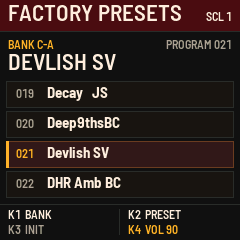
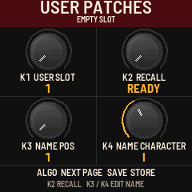

# Contagion 1.1

Contagion is a dual-core, eight-voice wavetable synth firmware for the M‑VAVE FM‑1. Version 1.1 contains all 1,525 factory presets in one image, a 34-table flash cache, and a USB‑C MIDI patch editor. [Sound sample](Sound%20Sample.mp3)

## Downloads

- [Contagion 1.1 firmware and USB editor](https://github.com/Kayman18/Contagion/releases/tag/v1.1.0)
- [Firmware checksums](firmware/SHA256SUMS)
- [USB editor source and setup](web-editor/README.md)

Install `Contagion-1.1-All-Banks-8V.fwsc` through the FM‑1 updater. The update includes the verified wavetable cache and uses firmware ID `FM-1_15009008`. Back up any important USER patches before updating.


Original zero-based program numbers are preserved. Arpeggiated programs were skipped during import, which leaves gaps. The USB MIDI SysEx protocol reads and writes the 16 native USER slots. Importing original Virus bank dumps is a build-time operation.

## What changed in 1.1

- **SCL page 1 opens Factory Presets** with a four-row list and a highlighted selection. Page 2 contains USER patches.
- One firmware combines the 14 factory banks. The presets are packed losslessly, and block decoding happens in the main loop.
- The secondary flash stores 34 pre-rendered, full-precision wavetables. The firmware still rebuilds tables when needed.
- Factory and INIT patches default to volume 90. USER patches recall their saved volume.
- HOME holds the oscillator, mixer, saturation, voice, pitch bend, and Analog Boost pages. FX holds the Filter, Distortion, and EQ pages. EDIT jumps directly to Filter.
- Fast mono retriggers now use a fade. Hard starts and voice steals use a 64-sample fade, about 1.45 ms at 44.1 kHz.
- The browser editor sends supported controls over USB MIDI, recalls factory presets, and reads and verifies USER slots.

The original distortion and EQ remain available. This release follows the later test builds with the experimental Chorus and Drive removed.

## Screens

These are 240 × 240 framebuffer captures rendered by the firmware's host simulator.

| Loading splash | Oscillators | Filter |
| :---: | :---: | :---: |
|  |  |  |

| SCL factory browser | USER patches | Performance |
| :---: | :---: | :---: |
|  |  |  |

- Tap **SCL** to open Factory Presets. **K1** selects the bank, **K2** scrolls and loads programs in that bank, **K3** selects INIT, and **K4** adjusts patch volume. The dedicated **PRESET** encoder also opens the browser.
- Tap **SCL** again for USER patches. **K1** chooses a slot, **K2** recalls it, **K3/K4** edit the name, and **SAVE** stores the current patch.
- Turn **ALGO** to move through the pages. Repeated taps on **HOME**, **ENV**, **LFO**, **FX**, or **GLO** step through the section.
- **GLO → WAVE CACHE → FLASH HITS** counts pre-rendered tables loaded since startup. The first GLO page shows CPU average and peak, xruns, and deadlines.
- [MIDI controls](MIDI-CONTROLS.md)

## How the wavetables fit

| Data | Size |
| --- | ---: |
| Full rendered set, 64 waves × 14 pitch bands × 2,049 float32 samples | 7,343,616 bytes |
| Packed coefficient bank, including header and index | 90,426 bytes |
| 34 pre-rendered tables, index and checksums before padding | 278,956 bytes |
| 32 playable tables in the RAM cache | 262,272 bytes |

The packed size is for the coefficient bank itself. The firmware also keeps a shared sine lookup table and per-wave peak constants. Tables in RAM are indexed by **wave number and pitch band**. A slot holds one band of one wave, so several voices or oscillators can reuse the same slot.

### Coefficients in flash

Each wave carries 128 sine and 128 cosine weights as binary64 values. The coefficients are stored in independently compressed blocks, so the firmware can decode a single wave by consulting its offset and length in the index. The bank reader checks the header, index, and payload CRCs and verifies each unpacked 2,048-byte coefficient block. See [bank decoder](runtime/wavetable_bank.c).

The app reads these coefficients from its own embedded bank on all FM‑1 units. The updater installs an additional 276 KiB data image at `0x97000–0xDBFFF`. It holds 34 float32 tables, a CRC32 for each table, and a CRC32 for their index. The loader verifies the package before writing and verifies the data again after programming. USER storage is outside this span.

On a cache hit, the app copies the pre-rendered samples into a playback slot in RAM. It checks the index at startup and checks each table on first use. A miss or bad checksum falls back to the embedded coefficients. This avoids overwriting audio-owned RAM from the loader or reading serial flash in the sample loop.

### Rebuilding a playable table

1. The oscillator derives a band from pitch. Lower bands can retain more harmonics. Higher pitch bands cut progressively more partials to limit aliasing. The 14 bands use harmonic ceilings of 128, 96, 64, 48, 32, 24, 16, 12, 8, 6, 4, 3, 2, and 1.
2. The builder expands one wave's coefficients into scratch memory. For each sample it adds the selected harmonics in reference order. The cosine lookup is the same sine table shifted by a quarter cycle.
3. It computes 32-sample tiles with double-precision accumulation, applies the wave's normalization and stores float32 samples. Sample 2,048 repeats sample zero so interpolation wraps without a special case.
4. The result becomes eligible for playback only after all tiles are written. All 896 reconstructed wave-band pairs matched the float32 reference byte for byte. See [reconstruction](runtime/wavetable_rebuild.c).

### Scheduling and moving between waves

On startup or preset recall, the app mutes while it prepares the selected waves. It warms the fundamental and bands 0–4 for each of the three oscillator selections, reusing duplicates. This gives typical notes an immediately usable table. A loading indicator remains visible during startup.

During playback, up to 24 oscillator clients request wave-band pairs. Cache misses are serviced in bounded slices by the main loop. The audio workers keep rendering while replacements are built. A cold note can use a smaller harmonic set of the same wave while it waits for the exact band. A wave with very little fundamental energy can sound thinner or nearly silent during that window. A fast modulation sweep can move through selections faster than the builder completes them, so intermediate requests may be superseded.

The cache publishes completed pointers at an audio boundary. It pins old and new tables until the audio side acknowledges the handoff, preventing a renderer from reading a slot while it is being reused. The oscillator keeps its phase and applies a 128-sample correction to smooth the change in output. The 32-sample de-click fades for fast attacks and stolen voices are separate from the table transition. See [cache scheduling](runtime/wavetable_cache.c), [handoff](runtime/wavetable_handoff.c), and [oscillator binding](runtime/wavetable_voice.c).

## Audio and build

The synth runs at **44.1 kHz**, with a **512-frame audio buffer**. The firmware splits voice rendering and channel post-processing across both cores. The 8-voice pool is shared by all notes and by unison layers, with up to four layers per note. If the renderer crosses its overload threshold, it may fade out a voice already in release.

Use Linux on x86-64 with Node.js, Python 3, the JieLi PI32v2 toolchain, and the AC79 SDK. [Toolchain helper](base/tools/get_toolchain.sh) · [SDK helper](base/bsp/tools/get_sdk.sh)

```sh
export JIELI_TOOLCHAIN=/path/to/jieli-linux-toolchains
export AC79_SDK=/path/to/fw-AC79_AIoT_SDK
./build-firmware.sh
```

The build emits `app/build/contagion-0.90.8.fwsc`. It generates the indexed factory preset blocks, packed EQ coefficients, and the 34-table wave image from the checked-in inputs. To build the Linux simulator, run `./build-firmware.sh --host`. To regenerate the standalone USB editor, run `node web-editor/generate.cjs` after a build.

The package, secondary flash writes, SCL navigation, and the USB editor's USER slot round-trip passed in simulation. Physical verification of this exact image is pending.

## Credits

Contagion builds on VIROOOS, fm1-base, and the Felucca BSP. The included platform and board license notices are in [base/LICENSES](base/LICENSES/) and [base/bsp/LICENSES](base/bsp/LICENSES/). Access and Virus identify the instrument and preset families. Contagion is an independent FM‑1 firmware project.

