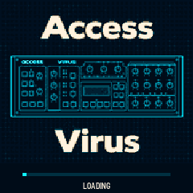
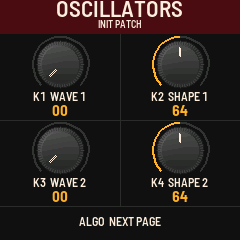
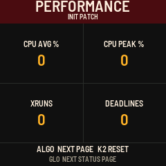

# Contagion

Contagion is a dual-core, eight-voice wavetable synth firmware for the M‑VAVE FM‑1. It uses the VIROOOS engine with a cyan blueprint boot screen and four physical controls per page. The three firmware images share the same engine, 64 oscillator waveforms, and USER patch format.

## Firmware

| Factory presets | Banks | Programs | Download |
| --- | --- | ---: | --- |
| Virus A | A–B | 227 | [Contagion-Virus-A-8V.fwsc](firmware/Contagion-Virus-A-8V.fwsc) |
| Virus B | A–F | 648 | [Contagion-Virus-B-8V.fwsc](firmware/Contagion-Virus-B-8V.fwsc) |
| Virus C | A–F | 650 | [Contagion-Virus-C-8V.fwsc](firmware/Contagion-Virus-C-8V.fwsc) |

Choose one firmware for the factory preset collection you want. Install the `.fwsc` through your usual FM‑1-compatible updater. Back up any important USER patches before flashing. The preset numbers are zero-based and retain the positions in the original SysEx dumps. Programs with arpeggiation enabled were skipped, so some program numbers are gaps. The Virus C presets carry the same program payloads as the earlier C–H set with the supplied A–F bank labels. For example, old C2 is A2, and old E16 is C16.

The factory files are converted at build time. The synth's USB MIDI SysEx backup and restore serve the 16 native USER slots. Original Virus bank dumps require the build-time importer. Factory sounds can differ where the original patches use unsupported functions such as delay, reverb, chorus, phaser, vocoder, or external input.

## Screens

These are 240 × 240 framebuffer captures rendered by the firmware's host simulator.

| Loading splash | Oscillators | Filter |
| :---: | :---: | :---: |
|  |  |  |

| USER patches | Performance |
| :---: | :---: |
|  |  |

- Turn **ALGO** to move between pages and **K1–K4** to edit the four controls on the current page.
- Tap **HOME**, **EDIT**, **ENV**, **LFO**, or **FX** to jump to a section. Repeated taps advance through that section's pages.
- Turn **PRESET** to browse sounds. On the factory page, **K1** selects the bank and **K2** selects the program. MIDI CC0 selects the zero-based bank and Program Change selects the program.
- Tap **SEL** for USER patches. **K1** chooses a slot, **K2** recalls it, **K3/K4** edit the name, and **SAVE** stores it.
- Tap **GLO** for CPU average, peak, xruns, and deadlines. Tap it again to reach core timing, core status, wave cache, and cache budget. **K2** resets counters on these pages.
- See [MIDI controls](MIDI-CONTROLS.md) for parameter assignments.

## How the wavetables fit

| Data | Size |
| --- | ---: |
| Full rendered set, 64 waves × 14 pitch bands × 2,049 float32 samples | 7,343,616 bytes |
| Packed coefficient bank, including header and index | 90,426 bytes |
| 32 reconstructed tables in the RAM cache | 262,272 bytes |

The packed size is for the coefficient bank itself. The firmware also keeps a shared sine lookup table and per-wave peak constants. Tables in RAM are indexed by **wave number and pitch band**. A slot holds one band of one wave, so several voices or oscillators can reuse the same slot.

### Coefficients in flash

Each wave carries 128 sine and 128 cosine weights as binary64 values. The coefficients are stored in independently compressed blocks, so the firmware can decode a single wave by consulting its offset and length in the index. The bank reader checks the header, index, and payload CRCs and verifies each unpacked 2,048-byte coefficient block. See [bank decoder](runtime/wavetable_bank.c).

On the original Puya flash, the firmware can install the packed bank into the reserved data area starting at `0x97000`, verify the copy, and reuse it on subsequent boots. It also supports extra prebuilt LFO tables in their own flash region at `0xAE000`. On newer UC25HQ80 units (JEDEC `B36014`), it reads coefficients directly from the embedded firmware image and reconstructs custom LFO waves into their active RAM slots. This avoids a wave-bank rewrite at boot on that chip and keeps USER patch storage available.

### Rebuilding a playable table

1. The oscillator derives a band from pitch. Lower bands can retain more harmonics. Higher pitch bands cut progressively more partials to limit aliasing. The 14 bands use harmonic ceilings of 128, 96, 64, 48, 32, 24, 16, 12, 8, 6, 4, 3, 2, and 1.
2. The builder expands one wave's coefficients into scratch memory. For each sample it adds the selected harmonics in reference order. The cosine lookup is the same sine table shifted by a quarter cycle.
3. It computes 32-sample tiles with double-precision accumulation, applies the wave's normalization and stores float32 samples. Sample 2,048 repeats sample zero so interpolation wraps without a special case.
4. The result becomes eligible for playback only after all tiles are written. All 896 reconstructed wave-band pairs matched the float32 reference byte for byte. See [reconstruction](runtime/wavetable_rebuild.c).

### Scheduling and moving between waves

On startup or preset recall, the app mutes while it prepares the selected waves. It warms the fundamental and bands 0–4 for each of the three oscillator selections, reusing duplicates. This gives typical notes an immediately usable table. A loading indicator remains visible during startup.

During playback, up to 24 oscillator clients request wave-band pairs. Cache misses are serviced in bounded slices by the main loop. The audio workers keep rendering while replacements are built. A cold note can use a smaller harmonic set of the same wave while it waits for the exact band. A wave with very little fundamental energy can sound thinner or nearly silent during that window. A fast modulation sweep can move through selections faster than the builder completes them, so intermediate requests may be superseded.

The cache publishes completed pointers at an audio boundary. It pins old and new tables until the audio side acknowledges the handoff, preventing a renderer from reading a slot while it is being reused. The oscillator keeps its phase and applies a 128-sample correction to smooth the change in output. The 32-sample de-click fades for fast attacks and stolen voices are separate from the table transition. See [cache scheduling](runtime/wavetable_cache.c), [handoff](runtime/wavetable_handoff.c), and [oscillator binding](runtime/wavetable_voice.c).

## Audio and build

The synth runs at **44.1 kHz**, with a **512-frame audio buffer**. The firmware splits voice rendering and channel post-processing across both cores. The 8-voice pool is shared by all notes and by unison layers, with up to four layers per note. If the renderer crosses its overload threshold, it may fade out a voice already in release.

Use Linux with Node.js, Python 3, and the JieLi PI32v2 toolchain and AC79 SDK. See the platform's [toolchain helper](base/tools/get_toolchain.sh) and [SDK helper](base/bsp/tools/get_sdk.sh). The app and its build inputs are included alongside the platform and board source.

```sh
export JIELI_TOOLCHAIN=/path/to/jieli-linux-toolchains
export AC79_SDK=/path/to/fw-AC79_AIoT_SDK
VIRUS_MODEL=A ./build-firmware.sh
VIRUS_MODEL=B ./build-firmware.sh
VIRUS_MODEL=C ./build-firmware.sh
```

Build one bank variant at a time because each run regenerates the shared preset and modulation tables. The source defaults to the Virus C factory set. The images are emitted under `app/build/`, with identities `FM-1_15008108`, `FM-1_15008208`, and `FM-1_15008308` respectively. `VIRUS_BANK_DIR` can point to a directory of correctly named, checksum-valid Virus bank files. Regenerate the splash with Pillow using `python3 tools/generate-access-ui.py assets/blueprint-splash.png`.

Build the Linux simulator with `./build-firmware.sh --host`. The resulting executable is `app/build/host/contagion_host`.

## Credits

Contagion builds on VIROOOS, fm1-base, and the Felucca BSP. The included platform and board license notices are in [base/LICENSES](base/LICENSES/) and [base/bsp/LICENSES](base/bsp/LICENSES/). Access and Virus identify the instrument and preset families. Contagion is an independent FM‑1 firmware project.
